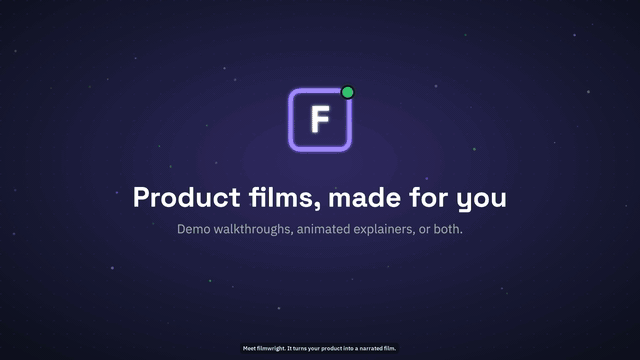

# filmwright

**Narrated product films, made on your own machine.** Record a walkthrough of your web app, make a fully
animated explainer, or cut both into one film, then pick the voice, presenter, music mood and output formats
with a one-page `reel.yaml`.

Everything runs locally: the browser, the voices, the music, the encoding. Nothing is uploaded.

<a href="docs/media/filmwright-sample.mp4"></a>

**[▶ Watch the 30-second sample with sound](docs/media/filmwright-sample.mp4)**, made with filmwright itself
([source](docs/media/sample/film.yaml)).


<sub>Frames from the bundled examples (fictional Acme products, sample data).</sub>

| | **Demo walkthrough** | **Animated explainer** | **Both** |
|---|---|---|---|
| What it shows | Your real app, recorded in a browser | Characters, whiteboard sketches, motion graphics | Animated scenes and recordings in one film |
| Made from | `scenarios.yaml` (what to click) + `video.yaml` (what to say) | `stories.json` (one story per film) or a feature montage | `film.yaml` (scenes and clips, in order) |
| Camera | Zooms on every real click, typing and scroll | Frame-exact animation, identical on every render | Both |

## Options

| Choice | Options |
|---|---|
| Film type | `demo`, `explainer` (`story` or `montage`), `both` |
| Narration voice | `preset` (built-in narrators), `described` (describe a voice in words), `clone` (your own voice, with consent), `system` (works anywhere) |
| Talking head | an animated, lip-synced presenter in the corner, 10 characters, or none |
| Music | original score in a mood: `upbeat`, `calm`, `corporate`, `inspiring`, `playful`, `epic`, `sad`, `suspense`, or `none`; downbeats land on scene changes |
| Captions | small and burned in at the bottom, plus an `.srt` |
| Outputs | `4k`, `hd`, `vertical` (9:16), `square` (1:1), `web` (720p/480p + WebVTT), `gif` teaser |
| Disclosure | note the synthetic voice in the file metadata, on an end card, or not at all |

## Quick start

```bash
pip install "git+https://github.com/dassjaylabs/filmwright"
filmwright setup             # ffmpeg, open-source Chromium, espeak-ng, Rhubarb Lip Sync
filmwright doctor            # what this machine can run

filmwright new my-film       # answers a few questions, writes my-film/reel.yaml and starter files
filmwright build my-film     # makes the film; files land in my-film/out/final/
```

`filmwright new` asks what you're making:

```
What are you making?
  1. Demo walkthrough: record your real product in a browser, narrated, with zooms on each action (default)
  2. Animated explainer: characters, whiteboard sketches and motion graphics, no screen recording
  3. Both: animated scenes and screen recordings in one narrated film
Narration voice?
  1. Preset voice  2. Described voice  3. Cloned voice  4. System voice
Add an animated talking-head presenter? [y/N]
Music?  upbeat · calm · corporate · inspiring · playful · epic · sad · suspense · none
Outputs (4k, hd, vertical, square, web, gif) [4k,hd]
```

Every question has a flag, so scripts and CI can skip the prompts:

```bash
filmwright new launch-film --mode explainer --format story --voice preset --talking-head no \
  --music inspiring --outputs 4k,hd,square --yes
```

### Try the examples

```bash
git clone https://github.com/dassjaylabs/filmwright && cd filmwright
pip install -e .
filmwright build examples/demo-app      # records the bundled sample app "Acme Tasks" and narrates it
filmwright build examples/explainer     # three animated story films
filmwright build examples/montage       # a one-minute feature montage in 16:9, 9:16 and 1:1
python examples/both/make_sample_clip.py && filmwright build examples/both   # animation + a recording
```

The examples use **Acme**, a fictional company, and sample data. [examples/README.md](examples/README.md) lists all
eight, from a feature montage for a gym app to stories in a cloned voice.

## Voices

| Voice | Needs | Notes |
|---|---|---|
| `preset` | Apple Silicon, one-time model download (`filmwright setup --voice preset`) | Built-in narrators such as `ryan` and `aiden`; each sentence is checked by transcription and regenerated if garbled |
| `described` | as above (`--voice described`) | "Warm, unhurried narrator with a gentle British accent" |
| `clone` | as above (`--voice clone`) and a short recording | **Consent required**: see below |
| `system` | nothing (espeak-ng) | Robotic, but works on any machine and in CI |

The neural voices are [Qwen3-TTS](https://huggingface.co/Qwen) 1.7B, and
[Whisper](https://huggingface.co/openai/whisper-large-v3-turbo) large-v3-turbo listens to every sentence it speaks:
a garbled, cut-off or runaway take is regenerated before it reaches the film. See [What's inside](#whats-inside).

On machines without Apple Silicon, `preset` and `described` fall back to the system voice with a note; a cloned
voice never falls back silently.

### Voice cloning and consent

Clone only your own voice, or a voice whose owner has agreed. filmwright records the speaker, has them confirm a
consent statement, and stores a consent record tied to the exact recording (its SHA-256). Clone mode refuses to
run without a matching record, and there is no setting that skips it.

```bash
filmwright voice clone passage                       # text to read aloud
filmwright voice clone record --speaker "Your Name"  # record it, then confirm consent
filmwright voice clone preview --play
```

For a full desktop voice-cloning app built on the same voice models, see
[clodio](https://github.com/dassjaylabs/clodio).

## What's inside

Every model and tool runs on your machine. The models download once, only for the voice type you choose
(`filmwright setup --voice preset|described|clone`).

| Part | What does it | Used for | Size · licence |
|---|---|---|---|
| Narration, `preset` | [Qwen3-TTS 1.7B CustomVoice](https://huggingface.co/Qwen) on [MLX](https://github.com/ml-explore/mlx) via [mlx-audio](https://github.com/Blaizzy/mlx-audio) | built-in narrators | 4.2 GB · Apache-2.0 |
| Narration, `described` | Qwen3-TTS 1.7B VoiceDesign, then Base | designs a voice from a sentence, then keeps it consistent across the film | 4.2 GB each · Apache-2.0 |
| Narration, `clone` | Qwen3-TTS 1.7B Base | speaks in a consented recorded voice | 4.2 GB · Apache-2.0 |
| Read-back check | [Whisper large-v3-turbo](https://huggingface.co/openai/whisper-large-v3-turbo) (MLX) | transcribes every narrated sentence to catch bad takes; writes the transcript of a clone recording | 1.6 GB · MIT |
| Narration, `system` | [espeak-ng](https://github.com/espeak-ng/espeak-ng) | works anywhere, no download | GPL-3.0 (run as a separate program) |
| Music | filmwright's own composer, synthesised with NumPy. **No AI music model** | an original score per mood, with downbeats on scene changes | built in · MIT |
| Sound effects | filmwright's own synthesiser | clicks, whooshes, risers, impacts | built in · MIT |
| Talking head | [Rhubarb Lip Sync](https://github.com/DanielSWolf/rhubarb-lip-sync) + filmwright's SVG characters | mouth shapes timed to the narration | MIT |
| Recording and animation | [Playwright](https://playwright.dev) + Chromium, filmwright's `motion.js` | records the web app; renders animated scenes frame by frame | Apache-2.0 / BSD |
| Encoding | [ffmpeg](https://ffmpeg.org) | mixing, captions, every output format | LGPL/GPL (run as a separate program) |

Why no music model: local music models are gigabytes, often licensed for non-commercial use only, give a different
track each run and can't land a downbeat on an exact cut. The built-in composer has none of those problems and
needs no setup. Demo films can use your own royalty-free track instead (`music: {file: ...}`, see
[docs/film.md](docs/film.md)); more on the composer in [docs/music.md](docs/music.md).
Full list with versions: [THIRD_PARTY_LICENSES.md](THIRD_PARTY_LICENSES.md).

## Disclosure

`disclosure: metadata` (the default) writes "Narration uses a synthetic voice" (or "a cloned voice, used with
consent") into each video's metadata. `end-card` also adds a two-second closing card. `none` adds nothing. Check
the rules that apply where you publish: some platforms and jurisdictions require disclosing synthetic or
altered media.

## Documentation

- [Configuration (`reel.yaml`)](docs/configuration.md) · [Install](docs/install.md) · [Architecture](docs/architecture.md)
- Demo: [walkthroughs](docs/demo.md), [scenario steps](docs/scenario-dsl.md), [film options](docs/film.md), [series](docs/series.md)
- Explainer: [overview](docs/explainer.md), [story config](docs/story-config.md), [montage](docs/montage.md), [style guide](docs/style-guide.md)
- Both: [hybrid films](docs/hybrid.md)
- Shared: [voice](docs/voice.md), [music](docs/music.md), [presenter](docs/presenter.md), [brands](docs/brands.md), [disclosure](docs/disclosure.md)

## Use it from Claude Code

This repository is also a Claude Code plugin. Inside Claude Code:

```
/plugin marketplace add dassjaylabs/filmwright
/plugin install filmwright@filmwright
```

Then ask for "a demo video of the new settings page" or "three animated explainers for our onboarding". The
skill agrees the options with you, writes the scenarios or stories, builds the film and checks it.

## Requirements

- Python 3.11+, macOS or Linux. `filmwright setup` installs ffmpeg, espeak-ng, an open-source Chromium and Rhubarb
  Lip Sync, and prints any command that needs an admin password for you to run.
- Neural voices: Apple Silicon (MLX). Other platforms use the system voice for now.
- Rendering 4K is CPU-heavy. A 40-second animated film takes about two minutes on a recent Apple Silicon Mac.

## Contributing and license

Contributions are welcome. See [CONTRIBUTING.md](CONTRIBUTING.md) and the [Code of Conduct](CODE_OF_CONDUCT.md);
code contributions need a one-time [Contributor License Agreement](CLA.md). Report security issues privately
([SECURITY.md](SECURITY.md)).

MIT licensed. The filmwright name and logo are not covered by the license ([TRADEMARKS.md](TRADEMARKS.md)).
Everything filmwright bundles or installs is open source; see [THIRD_PARTY_LICENSES.md](THIRD_PARTY_LICENSES.md). The animation engine (`motion.js`) is part of this project.
